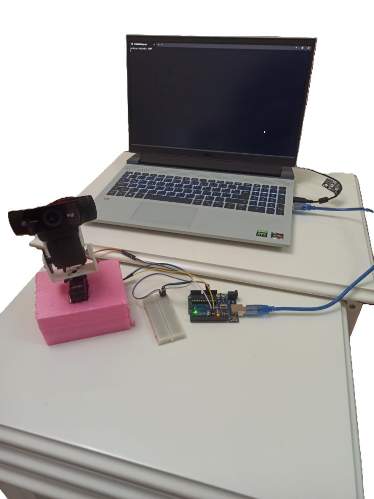
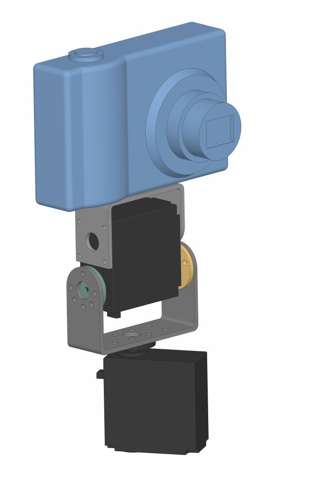
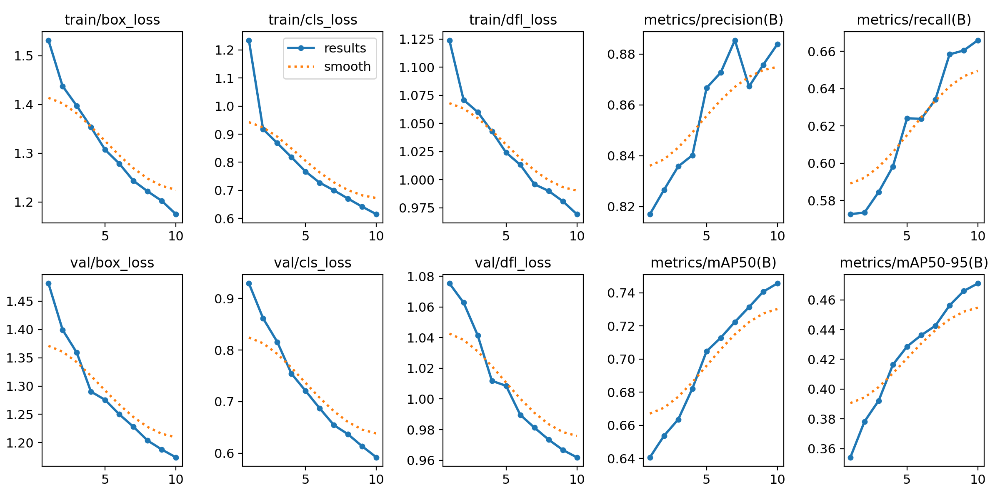
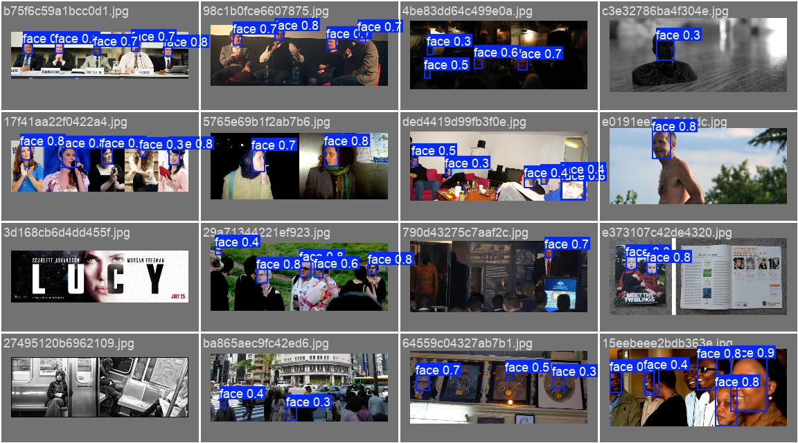
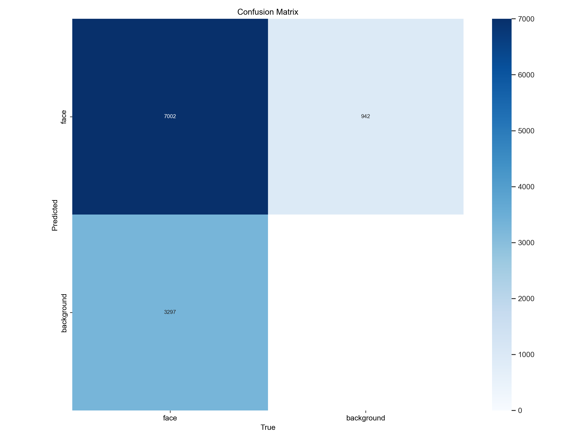
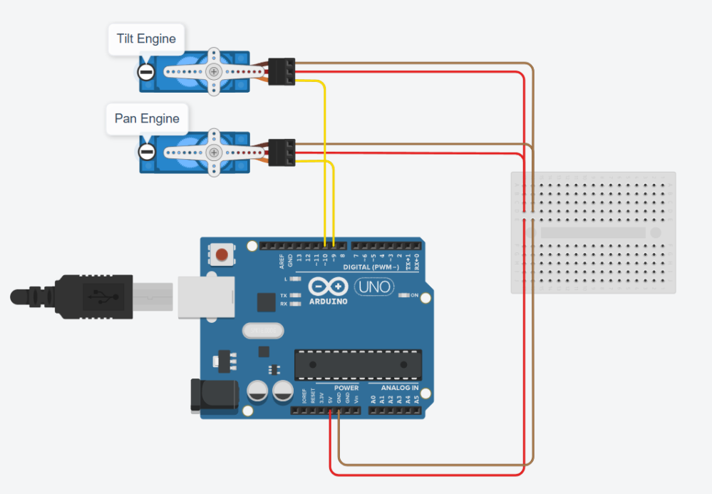

# 🎯 YOLOv8 ile Gerçek Zamanlı Yüz Takip Sistemi


Kameradan alınan görüntüde yüzü **YOLOv8** ile tespit eden ve iki servolu **pan-tilt** mekanizmasını **PID kontrol** ile yönlendirerek yüzü sürekli görüntünün merkezinde tutan otonom takip sistemi.

<p align="center">
  
  
</p>

## ⚙️ Nasıl Çalışır?

```
Kamera ──► YOLOv8 yüz tespiti ──► Yüz merkezi (x, y)
                                        │
                     Görüntü merkezinden sapma (hata)
                                        │
                              PID kontrolcü (X ve Y)
                                        │
                Seri port "pan,tilt" ──► Arduino ──► 2 servo motor
```

1. Kameradan 640×480 kare alınır.
2. Eğitilmiş YOLOv8n modeli yüzü tespit eder, sınırlayıcı kutunun merkezi hesaplanır.
3. Yüz merkezi ile görüntü merkezi arasındaki piksel farkı **hata** olarak alınır.
4. Her eksen için ayrı PID çıkışı servo açısını günceller. Titremeyi önlemek için Y ekseninde ölü bölge, integral için de windup sınırı vardır.
5. Açılar seri port üzerinden Arduino'ya gönderilir, servolar kamerayı yüze çevirir.
6. Program kapanırken hata, güven skoru ve servo açısı zaman serisi grafikleri ile FPS istatistikleri kaydedilir.

## 🧠 Yüz Tespit Modeli

YOLOv8n, önceden eğitilmiş ağırlıklardan başlanarak (transfer learning) tek sınıflı (`face`) bir yüz veri setiyle yeniden eğitildi.

| Ayar | Değer |
|---|---|
| Temel model | YOLOv8n (~3M parametre) |
| Görüntü boyutu | 240 px (gerçek zamanlı hız için küçük tutuldu) |
| Epoch / batch | 10 / 16 |

**Doğrulama sonuçları:**

| Precision | Recall | mAP50 | mAP50-95 |
|---|---|---|---|
| 0.884 | 0.666 | 0.746 | 0.471 |

<p align="center">
  
</p>
<p align="center">
  
  
</p>

## 🔧 Donanım

- USB web kamerası
- Arduino Uno
- 2 × servo motor (pan: pin 9, tilt: pin 10)
- 3D yazıcıda basılmış pan-tilt braketi

<p align="center">
  
</p>

## 📁 Proje Yapısı

```
├── src/
│   ├── face_tracker.py        # Tespit + PID + seri haberleşme (ana program)
│   └── train.py               # YOLOv8 eğitim scripti
├── arduino/
│   └── arduino_controller.ino # "pan,tilt" komutlarını servolara uygular
├── models/
│   └── best.pt                # Eğitilmiş yüz tespit modeli
├── training/                  # Eğitim çıktıları (metrikler, eğriler, ayarlar)
└── docs/                      # Sistem fotoğrafları ve devre şeması
```

## ▶️ Çalıştırma

1. `arduino/arduino_controller.ino` dosyasını Arduino'ya yükleyin.
2. Bağımlılıkları kurun ve takibi başlatın:
   ```bash
   pip install -r requirements.txt
   python src/face_tracker.py
   ```
3. Çıkmak için `q` tuşuna basın.

Arduino seri portu otomatik bulunur. Dahili kamera kullanacaksanız `face_tracker.py` içindeki `CAMERA_INDEX` değerini `0` yapın.

**Modeli yeniden eğitmek için:** YOLO formatındaki veri setini `datasets/face/images/{train,val}` klasörlerine koyun ve `python src/train.py` çalıştırın.

## 👥 Ekip

İki kişilik ekip projesi:
- **[Osman Karabağ](https://github.com/osmankarabag):** Görüntü işleme. Yüz tespit modelinin eğitimi ve değerlendirilmesi, tespit hattı, görselleştirme.
- **Ekip arkadaşım:** Kontrol sistemi. PID tasarımı, servo ve Arduino tarafı.

## 🚀 Geliştirme Fikirleri

- Daha yüksek recall için daha uzun eğitim ve veri artırma (augmentation)
- Kareler arası takip (ByteTrack) ile ID koruma ve titreşimin azaltılması
- Modeli ONNX/TensorRT'ye dönüştürüp Jetson veya Raspberry Pi üzerinde gömülü çalıştırma
